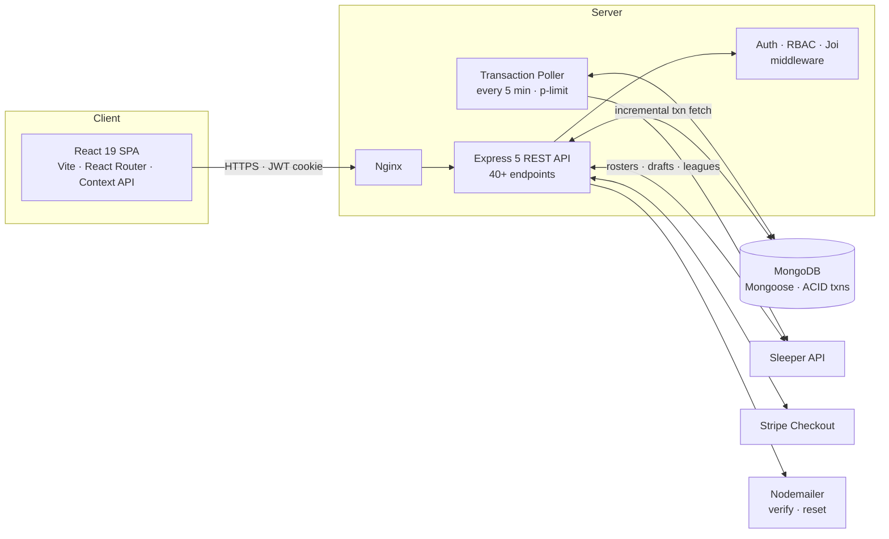

<div align="center">

# 🏈 LeagueHQ

**Add a new dimension to fantasy football with contracts, salaries, and salary cap management.**


[Overview](#overview) • [Features](#-key-features) • [Engineering Highlights](#-engineering-highlights) • [Architecture](#%EF%B8%8F-architecture) • [Getting Started](#-getting-started)

</div>

---

## Overview
LeagueHQ is a full-stack companion application designed to extend the Sleeper API. While Sleeper handles the real-time scoring and matchmaking, LeagueHQ acts as the financial "Source of Truth," managing complex stateful data that the native platform does not support.

It introduces a sophisticated Salary Cap Engine that allows leagues to implement custom contract logic, salary inflation, and cap-hit calculations—transforming a standard dynasty league into a comprehensive front-office simulation.


## 🎯 Goal for This Project
While [Sleeper](https://sleeper.com/) is the premier platform for dynasty fantasy football, it lacks native support for real-life salary cap mechanics (contracts, extensions). 

LeagueHQ is a specialized management layer for hardcore leagues. It bridges the gap between traditional fantasy football and the true NFL front-office simulation by providing commissioners with the tools to enforce financial parity and strategic long-form roster construction

---

## Key Features
| | Feature | Description |
|---|---|---|
| 🔄 | **Sleeper roster sync** | Instantly imports league rosters and player data using the Sleeper API. |
| 📝 | **Contract management** | Assign multi-year contracts, track salaries, and simulate salary cap impacts of potential trades. |
| 📊 | **Dashboard** | High level visualization of cap space for current and future seasons. |
| ⚡ | **Transaction tracking** | Automatically calculates salary cap impact of trades and waiver wire claims in real time. |
| 📥 | **Draft importing** | Contracts can be imported from auction drafts (salary is the highest bid) or from rookie drafts (salary determined by round). |
| 🔁 | **Contract extensions** | Extend eligible contracts with a league-configurable annual price hike and max extension length. |
| 🤝 | **Trade Center** | Build hypothetical trades between any two rosters and see the cap impact on both sides before you hit accept in Sleeper. |
| 🛡️ | **Full control** | Commissioners have full control to create, delete, and edit contracts manually to match your league's specific rules.

---

## 🧠 Engineering Highlights

### Background transaction-sync engine
A long-running poller (`backend/services/transaction_poller.js`) keeps LeagueHQ in sync with Sleeper without any user action.
- **Incremental, cursor-based polling:** each league stores a `{round, txn_id}` checkpoint per Sleeper season, so every 5-minute cycle fetches only transactions newer than the last one processed instead of re-scanning the season.
- **Request deduplication:** leagues that share a Sleeper league ID are grouped so each one is fetched from Sleeper only once per cycle.
- **Rate-limited concurrency:** `p-limit` caps concurrent Sleeper requests at 5 so the third-party API isn't overloaded.
- **Event classification:** free-agent adds, commissioner moves, and FAAB waiver claims are each handled differently. Waiver pickups get a contract equal to their winning bid.
- **Chronological, idempotent writes:** transactions are applied oldest to newest. Contracts are created with `upsert` and `$setOnInsert`, so a repeated poll never creates duplicates. Drops only end contracts imported *before* the drop happened, which avoids race conditions with manual draft imports.
- **Graceful shutdown:** `SIGINT`/`SIGTERM` handlers stop the poller, drain the HTTP server, and close the database connection, with a 10-second forced-exit fallback.

### ACID data integrity with MongoDB transactions
Every multi-document operation runs inside a **MongoDB session transaction** with commit and rollback: draft imports, polling batches, contract deletion, league setup, registration, email changes, and cascading account deletion. A failure partway through never leaves the cap books half-updated. Bulk operations are batched in groups of 50 through `bulkWrite`.

### Salary cap engine & data modeling
- **Contract model** with start and end seasons, contract types (`auction`, `rookie`, `waiver`, `extension`, `created`), extension eligibility, and early termination. A **unique compound index** on `(player_id, league_id, start_year)` stops a player from ever holding two contracts in the same league year, and secondary indexes keep cap queries fast.
- **Draft import pipeline:** detects whether a draft is an auction, rookie-only, or veteran draft, checks that the draft belongs to the league and is complete, maps picks to rostered players, and creates contracts sized by auction bid or rookie round.
- **Auto-scaling rookie salary scale:** when a league's draft round count changes, default salaries for new rounds are derived from the cap with a geometric decay (`cap × 1.8% × 0.5^(round−1)`).
- **Multi-season league linking:** at setup the backend follows Sleeper's `previous_league_id` chain to build a `season → league ID` map, so contracts persist across years even though Sleeper issues a new league ID every season.

### Authentication & authorization
- Password hashing with **bcrypt**. **JWTs** are stored in `httpOnly`, `SameSite=strict` cookies, which blocks token theft through XSS and CSRF.
- Email verification and password reset flows built on cryptographically random tokens (`crypto.randomBytes`) and **Nodemailer**.
- Role-based access control: Express middleware checks league **owner and commissioner** roles before any write to league settings or contracts. Server-side input validation uses **Joi** schemas.

### Payments
- **Stripe Checkout** integration for per-league, per-season subscriptions, with purchase history for both users and leagues.
- Frontend route guards (`RequireSubscription`) gate premium pages behind an active trial or subscription.

### Frontend
- **React 19 + React Router 7 SPA** with roughly 25 pages and 48 reusable components.
- Global state through the **Context API** (`AuthContext`, `LeagueContext`, `TitleContext`), plus protected routes, owner-only routes, and subscription-gated routes.
- A custom **design-token system** (`theme.css`) as the single source of truth for color, spacing, and typography, which also powers the dark mode toggle.

### Deployment
- Production build served by **Nginx** as a reverse proxy in front of the Express API, with environment-based CORS for local development.

---

## 🏗️ Architecture



### Data model
| Collection | Purpose |
|---|---|
| `leagues` | League settings (cap, contract lengths, extension rules, rookie scale), season→Sleeper ID map, poller checkpoints, roles, team assignments |
| `contracts` | Player contracts, including salary, term, type, and extension eligibility |
| `transactions` | Audit log of trades, waivers, drops, draft imports, and manual commissioner edits |
| `users` | Accounts, hashed credentials, verification state, and league membership |
| `subscriptions` | Season-based league subscriptions linked to the purchasing user |
| `players` | NFL player reference data (position, team, age, experience) |

---

## 🛠️ Tech Stack
* **Frontend:** React.js (React 19, React Router 7, Vite)
* **Backend:** Node.js, Express.js
* **Database:** MongoDB (storing custom contract data not available via sleeper)
* **API:** Integration with the Sleeper API to sync league data
* **Auth & Security:** JWT, bcrypt, Joi validation, role-based middleware
* **Payments & Email:** Stripe Checkout, Nodemailer
* **Infrastructure:** Nginx, graceful-shutdown process management

---

## 🚀 Getting Started

### Prerequisites
- Node.js 18+
- A MongoDB **replica set** (required for multi-document transactions; MongoDB Atlas works out of the box)
- A Stripe account (test keys are fine)

### Installation
```bash
git clone https://github.com/vinnymaisano/leaguehq-new.git
cd leaguehq-new
npm install
```

### Environment variables
Create a `.env` file in the project root:
```env
NODE_ENV=development
PORT=5000
MONGO_URI=mongodb+srv://...
JWT_SECRET=your_jwt_secret
EMAIL_USERNAME=you@gmail.com
EMAIL_PASSWORD=your_app_password
SUBSCRIPTION_PRICE=...
URL=http://localhost:5173
```

### Run locally
```bash
npm run test     # runs the Vite dev server and the API (nodemon) together
# or separately:
npm run dev      # frontend → http://localhost:5173
npm run server   # backend  → http://localhost:5000
```

---

## 📁 Project Structure
```
leaguehq/
├── backend/
│   ├── config/         # MongoDB connection
│   ├── controllers/    # Route handlers (auth, league)
│   ├── middleware/     # JWT verification, commissioner RBAC
│   ├── models/         # Mongoose schemas
│   ├── routers/        # Express routers
│   ├── services/       # Business logic + background transaction poller
│   ├── utils/          # Token generation, email delivery
│   ├── validation/     # Joi schemas
│   └── server.js
└── frontend/
    └── src/
        ├── api/        # API helpers
        ├── components/ # 48 reusable UI components
        ├── contexts/   # Auth, League, Title providers
        ├── css/        # Design tokens + component styles
        └── pages/      # 25 route-level pages
```
